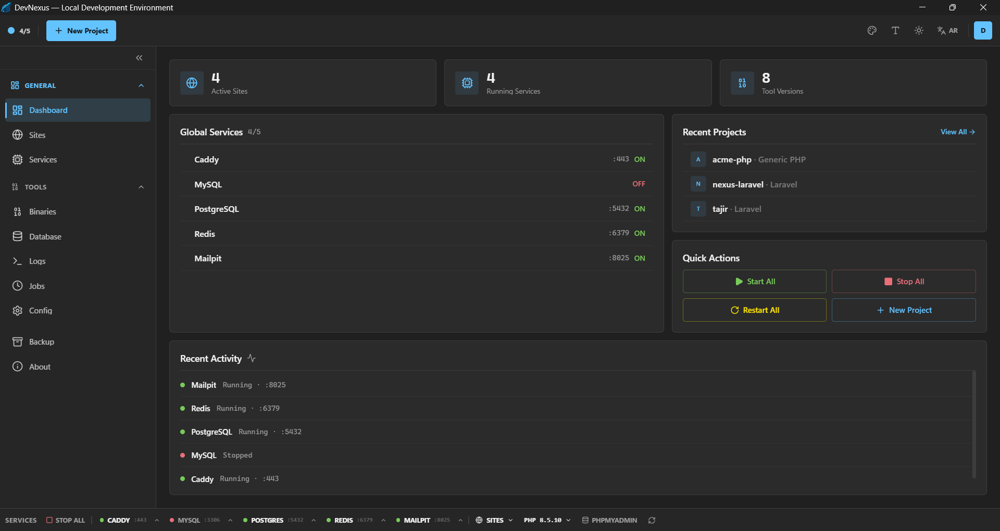

# DevNexus Documentation

**Version:** 0.4.0 | **Developer:** [smartTeam](https://www.smart.sd) | **Website:** [nexus.smart.sd](https://nexus.smart.sd)

---

DevNexus is a cross-platform desktop application for managing local PHP/Laravel development environments. Built with [Tauri v2](https://v2.tauri.app) (Rust backend + React/TypeScript frontend), it provides a GUI for downloading, configuring, and orchestrating all the services you need for local web development — and exposes its entire command surface to AI assistants over the MCP protocol.

---

## Documentation Index

| Document | Description |
|----------|-------------|
| [Getting Started](./getting-started.md) | Installation, system requirements, and first launch |
| [Architecture](./architecture.md) | Tech stack, directory structure, and design patterns |
| [CLI Reference](./cli.md) | `devnexus-cli` command-line interface documentation |
| [MCP Server](./mcp.md) | Embedded MCP server, AI client setup, tools, prompts, and resources |
| [Services](./services.md) | PHP, MySQL, Caddy, Redis, Mailpit, PostgreSQL — management and configuration |
| [Sites & Projects](./sites.md) | Project discovery, creation, linking, and per-site configuration |
| [Configuration](./configuration.md) | Directory layout, config files, and settings reference |
| [Backup & Restore](./backup.md) | Full, projects-only, and config backups with scheduling |
| [Development Guide](./development.md) | Building from source, quality gates, and coding conventions |
| [Contributing](./contributing.md) | How to contribute, commit conventions, and PR workflow |

---

## Quick Links

- **Releases:** [github.com/DevXNexusPro/DevNexus/releases](https://github.com/DevXNexusPro/DevNexus/releases)
- **Source Code:** [github.com/DevXNexusPro/Nexus-src](https://github.com/DevXNexusPro/Nexus-src)
- **Issues:** [github.com/DevXNexusPro/DevNexus/issues](https://github.com/DevXNexusPro/DevNexus/issues)

---

## Features at a Glance

| Feature | Description |
|---------|-------------|
| **PHP Version Manager** | Install and switch between PHP 8.0–8.4 with per-site isolation |
| **MySQL / PostgreSQL** | Database servers with phpMyAdmin integration |
| **Caddy Web Server** | Auto-configured reverse proxy with TLS for `.test` domains |
| **Redis** | In-memory data store for caching and queues |
| **Mailpit** | Local email testing with web UI |
| **Node.js / NVM** | Per-project Node version management with dev server proxy |
| **MCP Server** | 17 tools, 3 prompts, 2 resources for AI assistant integration |
| **CLI** | Full command-line interface for automation and scripting |
| **Job Scheduler** | Cron-like background task scheduling |
| **Queue Workers** | Laravel queue worker lifecycle management |
| **Self-Healing** | Automatic diagnostics and one-click fixes |
| **Backups** | Full, projects-only, and config backups with scheduling |

---

> **Smart Team** — [www.smart.sd](https://www.smart.sd)
