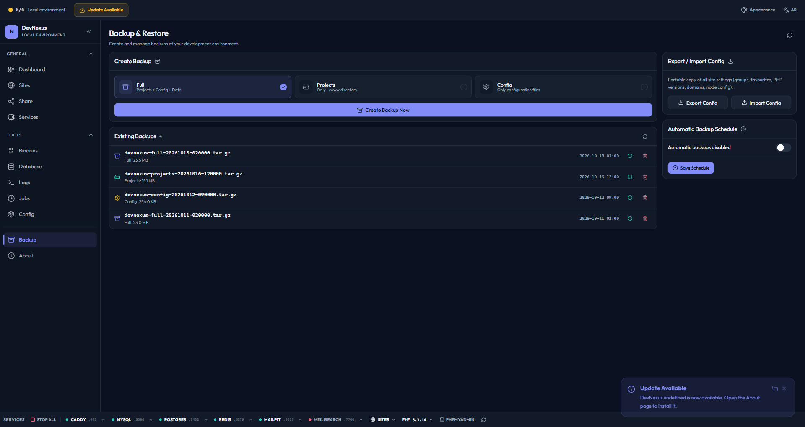
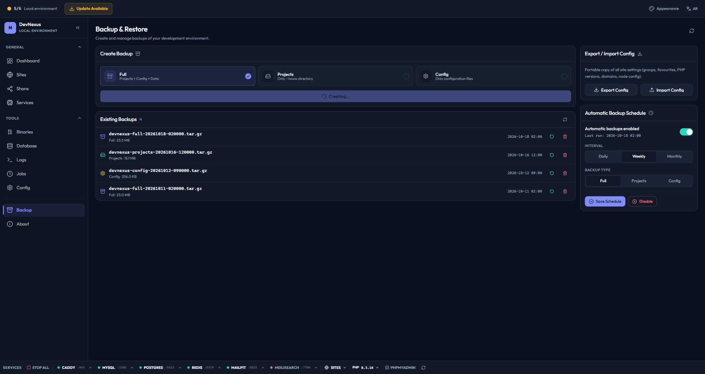
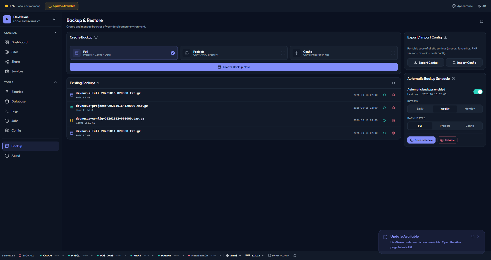
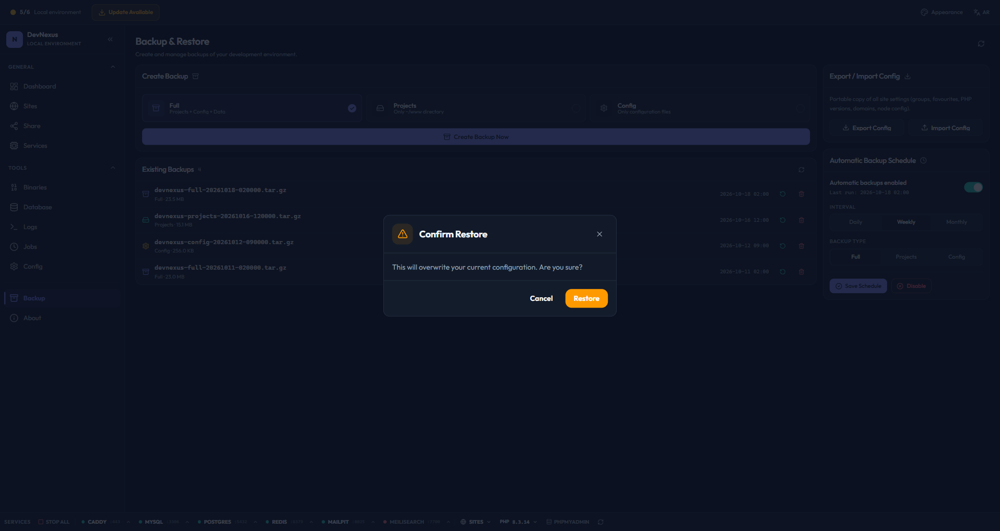

# Backup & Restore

DevNexus provides built-in backup and restore capabilities for your entire development environment.

---

## Overview



| Backup Type | Contents | Use Case |
|-------------|----------|----------|
| **Full** | Projects + Config | Complete environment backup |
| **Projects** | Project files only | Source code backup |
| **Config** | Configuration files only | Settings backup |

---

## Creating Backups

### From the GUI

1. Go to **Backup** page
2. Select backup type (Full, Projects, or Config)
3. Click **Create Backup**



### From the CLI

```bash
# Full backup
devnexus backup full

# Projects only
devnexus backup projects

# Config only
devnexus backup config
```

### From MCP

```
Tool: create_full_backup
Tool: create_projects_backup
```

---

## Listing Backups

### From the GUI

The Backup page shows all existing backups with:
- Filename
- Size
- Creation date
- Backup type

### From the CLI

```bash
devnexus backup list
```

**Output:**

```
Backups (3):
──────────────────────────────────────────────────
  backup-2026-09-03-143022.tar.gz  45.2 MB  2026-09-03 14:30:22  Full
  backup-2026-09-02-120000.tar.gz  38.1 MB  2026-09-02 12:00:00  Projects
  backup-2026-09-01-080000.tar.gz   2.3 MB  2026-09-01 08:00:00  Config
```

### From MCP

```
Tool: list_backups
```

---

## Scheduled Backups

DevNexus supports automatic backup scheduling:

### From the GUI

1. Go to **Backup** → **Schedule**
2. Select frequency: Daily, Weekly, or Monthly
3. Choose backup type
4. Enable scheduling



### From the Job Scheduler

Backups can also be scheduled via the built-in cron/job manager:

| Interval | Description |
|----------|-------------|
| **Minute** | Run every minute |
| **Hourly** | Run every hour |
| **Daily** | Run once per day |
| **Weekly** | Run once per week |
| **Monthly** | Run once per month |

---

## Backup Contents

### Full Backup

A full backup archive (`tar.gz`) contains:

```
backup-YYYY-MM-DD-HHMMSS.tar.gz
├── projects/                   # All project files
│   ├── my-app/
│   │   ├── app/
│   │   ├── composer.json
│   │   └── ...
│   └── blog/
│       ├── wp-content/
│       └── ...
├── config/                     # Configuration files
│   ├── Caddyfile
│   ├── my.cnf
│   ├── php/
│   │   ├── php.ini
│   │   └── fpm/
│   ├── redis.conf
│   └── app_config.json
└── metadata.json               # Backup metadata
```

### Projects Backup

Contains only the project directories:

```
backup-projects-YYYY-MM-DD-HHMMSS.tar.gz
├── my-app/
└── blog/
```

### Config Backup

Contains only configuration files:

```
backup-config-YYYY-MM-DD-HHMMSS.tar.gz
├── Caddyfile
├── my.cnf
├── php/
├── redis.conf
└── app_config.json
```

---

## Restore

### From the GUI

1. Go to **Backup** page
2. Select a backup from the list
3. Click **Restore**
4. Confirm the restore operation



### What Happens During Restore

1. Current configuration is backed up (safety net)
2. Selected backup is extracted
3. Configuration files are restored
4. Services are restarted with new config
5. Hosts file is re-synchronized

---

## Backup Storage

Backups are stored in:

```
dev-stack/backups/
```

| Platform | Path |
|----------|------|
| **Linux** | `~/.local/share/dev-stack/backups/` |
| **macOS** | `~/Library/Application Support/dev-stack/backups/` |
| **Windows** | `%APPDATA%/dev-stack/backups/` |

---

## Best Practices

1. **Regular backups:** Schedule daily backups for active projects
2. **Before upgrades:** Create a full backup before updating PHP or MySQL versions
3. **Before major changes:** Backup before migrating databases or restructuring projects
4. **Off-site copies:** Copy important backups to external storage
5. **Test restores:** Periodically verify backups can be restored

---

## Related

- [Configuration](./configuration.md) — What gets backed up
- [CLI Reference](./cli.md) — Command-line backup operations
- [MCP Server](./mcp.md) — AI-assisted backup management
