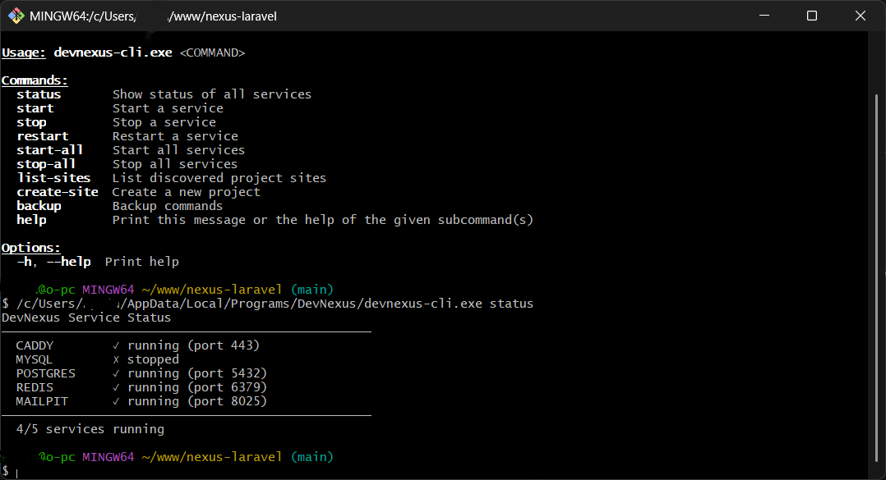

# CLI Reference

DevNexus ships with a standalone command-line interface (`devnexus-cli`) for managing your local development environment without the GUI.

---

## Overview

The CLI is a compiled Rust binary built with [clap](https://docs.rs/clap) for argument parsing. It shares the same business logic services as the GUI — no duplication.



---

## Installation

The CLI binary is bundled with DevNexus. After installing DevNexus:

- **Linux/macOS:** Available on PATH as `devnexus`
- **Windows:** Available as `devnexus.exe` in the installation directory

If not on PATH, you can build it from source:

```bash
cd src-tauri
cargo build --release --bin devnexus-cli
# Binary: target/release/devnexus-cli
```

---

## Commands

### `devnexus status`

Show the status of all managed services.

```bash
devnexus status
```

**Output:**

```
DevNexus Service Status
──────────────────────────────────────────────────
  CADDY        ✓ running (port 80)
  MYSQL        ✓ running (port 3306)
  POSTGRES     ✗ stopped
  REDIS        ✓ running (port 6379)
  MAILPIT      ✓ running (port 1025)
  PHPFPM       ✓ running (port 9000)
──────────────────────────────────────────────────
  5/6 services running
```

---

### `devnexus start <service>`

Start a background service.

```bash
devnexus start caddy
devnexus start mysql
devnexus start redis
```

**Available services:**

| Service | Aliases |
|---------|---------|
| `caddy` | — |
| `mysql` | — |
| `postgres` | `postgresql` |
| `redis` | — |
| `mailpit` | — |
| `phpfpm` | `php` |

---

### `devnexus stop <service>`

Stop a running service.

```bash
devnexus stop mysql
devnexus stop caddy
```

---

### `devnexus restart <service>`

Stop and then start a service.

```bash
devnexus restart caddy
```

---

### `devnexus start-all`

Start all managed services sequentially.

```bash
devnexus start-all
```

**Output:**

```
Starting all services...
  ✓ CADDY
  ✓ MYSQL
  ✗ POSTGRES: service not installed
  ✓ REDIS
  ✓ MAILPIT
  ✓ PHPFPM
```

---

### `devnexus stop-all`

Stop all managed services.

```bash
devnexus stop-all
```

---

### `devnexus list-sites`

List all discovered project sites in `~/www`.

```bash
devnexus list-sites
```

**Output:**

```
Discovered Sites (3):
──────────────────────────────────────────────────
  my-app (Laravel)
    → my-app.test [active]
  blog (WordPress)
    → blog.test [active]
  api (GenericPhp)
    → api.test [inactive]
```

---

### `devnexus create-site`

Create a new project.

```bash
devnexus create-site --name my-app --type laravel
```

**Options:**

| Flag | Short | Default | Description |
|------|-------|---------|-------------|
| `--name` | `-n` | (required) | Project name |
| `--type` | `-t` | `laravel` | Site type |

**Available types:**

| Type | Description |
|------|-------------|
| `laravel` | Laravel application |
| `wordpress` | WordPress site |
| `slim` | Slim framework |
| `cakephp` | CakePHP application |
| `genericphp` / `php` | Generic PHP project |
| `static` | Static HTML site |

---

### `devnexus backup`

Manage environment backups.

```bash
# Create a full backup (projects + config)
devnexus backup full

# Create a projects-only backup
devnexus backup projects

# Create a config-only backup
devnexus backup config

# List all existing backups
devnexus backup list
```

**Backup subcommands:**

| Subcommand | Description |
|------------|-------------|
| `full` | Back up everything (projects + configuration) |
| `projects` | Back up project files only |
| `config` | Back up configuration files only |
| `list` | List all available backups with sizes and dates |

**Output example:**

```
Creating full backup...
Backup created: backup-2026-09-03-143022.tar.gz (/home/user/.local/share/dev-stack/backups/backup-2026-09-03-143022.tar.gz)
```

---

## Hosts Repair Utility

A separate binary `repair-hosts` re-synchronizes `/etc/hosts` with discovered site domains.

```bash
# Build from source
cd src-tauri
cargo build --release --bin repair_hosts

# Run
./target/release/repair-hosts
```

**Output:**

```
Triggering hosts synchronization...
Successfully synchronized hosts!
```

This is useful when:
- Hosts entries were manually deleted
- After moving or renaming projects
- After a system update reset `/etc/hosts`

---

## Environment Variables

The CLI respects the same environment variables as the backend:

| Variable | Default | Description |
|----------|---------|-------------|
| `RUST_LOG` | `info` | Log level (`trace`, `debug`, `info`, `warn`, `error`) |

**Example:**

```bash
RUST_LOG=debug devnexus status
```

---

## Exit Codes

| Code | Meaning |
|------|---------|
| `0` | Success |
| `1` | Error (service not found, failed to start, etc.) |

---

## Scripting Examples

### Start all services and verify

```bash
devnexus start-all && devnexus status
```

### Daily backup cron job

```bash
# Add to crontab:
0 2 * * * /usr/local/bin/devnexus backup full
```

### List sites and open in browser

```bash
devnexus list-sites | grep "my-app" && xdg-open https://my-app.test
```

---

## Related

- [Services](./services.md) — Detailed service management
- [Backup & Restore](./backup.md) — Backup strategies and restoration
- [MCP Server](./mcp.md) — AI assistant integration (alternative to CLI)
