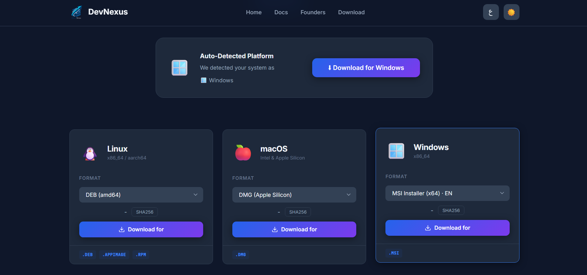
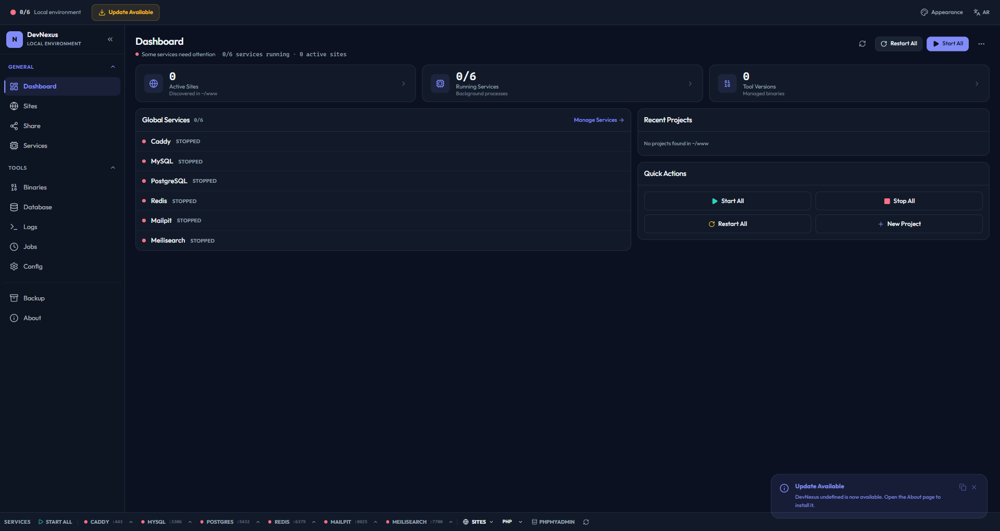
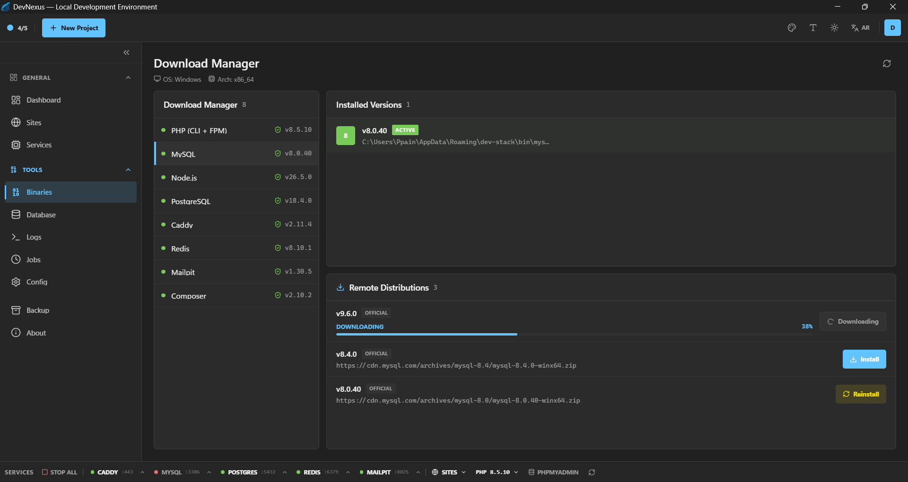
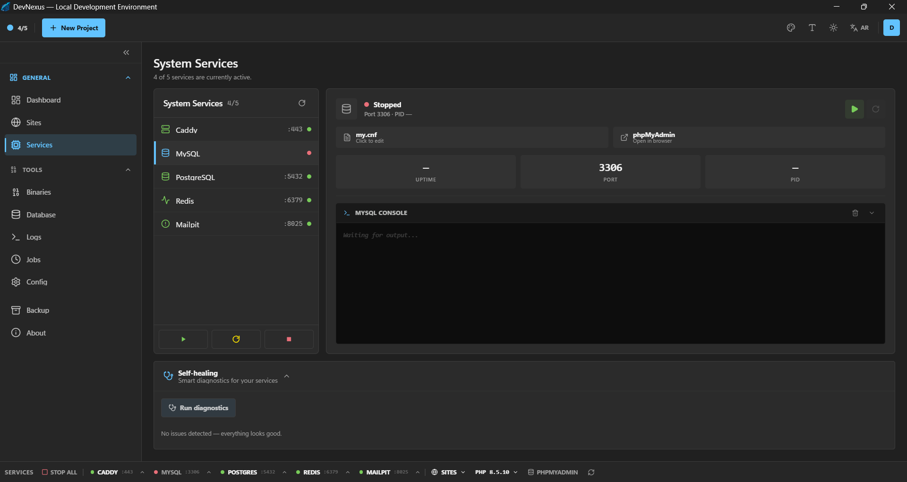
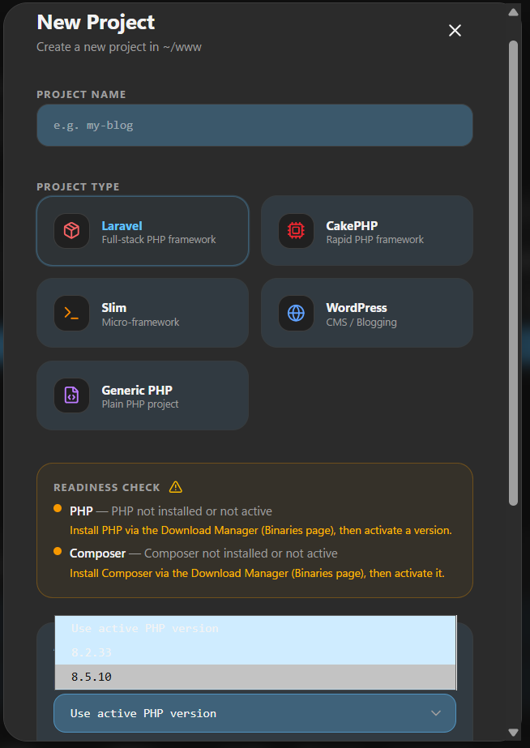
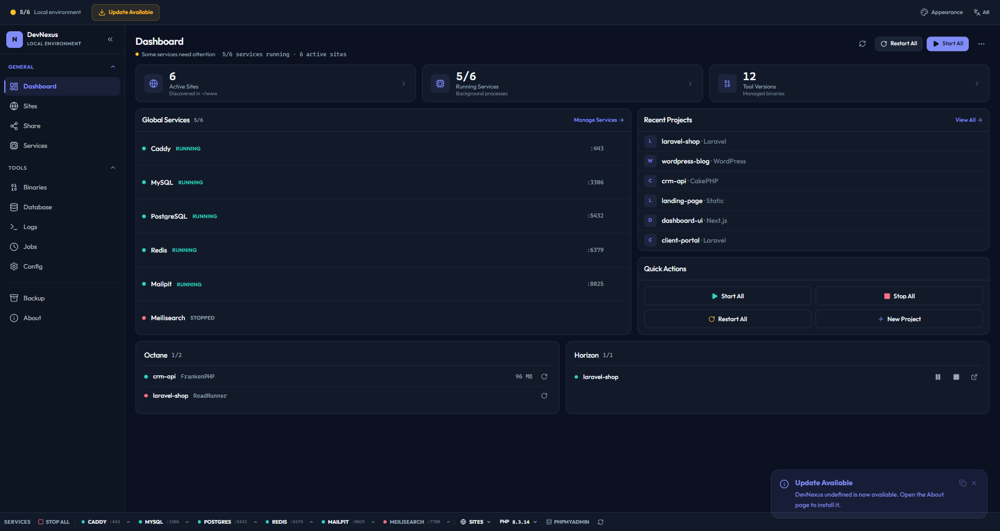

# Getting Started

This guide walks you through installing DevNexus and configuring your first local development environment.

---

## System Requirements

| Platform | Requirements |
|----------|-------------|
| **Linux** | glibc 2.28+, GTK 3, WebKit2GTK 4.1, `pkexec` (PolicyKit) |
| **macOS** | macOS 10.15+, Xcode CLI tools |
| **Windows** | Windows 10+, WebView2 |

---

## Installation

### Download from Releases

1. Go to the [Releases page](https://github.com/DevXNexusPro/DevNexus/releases)
2. Download the package for your OS:

| OS | Architecture | Package |
|----|-------------|---------|
| Linux | x86_64 | `.deb`, `.rpm`, `.AppImage`, `.pkg.tar.zst` |
| Linux | aarch64 | `.deb`, `.AppImage` |
| macOS | Intel (x86_64) | `.dmg` |
| macOS | Apple Silicon (aarch64) | `.dmg` |
| Windows | x86_64 | `.msi`, `.exe` (NSIS) |

3. Install and launch DevNexus



### Install from Source

```bash
# Prerequisites: Rust, Node.js, and system libraries
# https://v2.tauri.app/start/prerequisites/

git clone https://github.com/DevXNexusPro/Nexus-src.git
cd Nexus-src

# Install frontend dependencies
npm install

# Run in development mode
npm run tauri dev
```

---

## First Launch

When DevNexus starts for the first time, it will:

1. Create the data directory at the platform-specific location (see [Configuration](./configuration.md))
2. Scan `~/www` for existing projects
3. Present the Dashboard with an overview of your environment



---

## Downloading Tools

Before using services, you need to download the required binaries. Navigate to the **Binaries** page in the app:



| Tool | Purpose | Required |
|------|---------|----------|
| **PHP** | PHP runtime (choose a version) | Yes |
| **MySQL** | Database server | Optional |
| **Caddy** | Web server with auto-TLS | Yes |
| **Redis** | Cache / queue backend | Optional |
| **Mailpit** | Local email testing | Optional |
| **PostgreSQL** | Alternative database | Optional |

> DevNexus downloads pre-compiled binaries from official sources — no system package manager required.

---

## Starting Services

Once binaries are downloaded, go to the **Services** page to start them:



Click **Start All** or toggle individual services. DevNexus will:

- Start each service on its default port
- Detect and resolve port conflicts automatically
- Update the Dashboard with real-time status

---

## Creating Your First Project

### Option A: Create a new Laravel project

1. Go to **Sites** → **Create Site**
2. Enter a project name (e.g., `my-app`)
3. Select **Laravel** as the type
4. DevNexus will scaffold the project via `composer create-project`



### Option B: Link an existing project

1. Go to **Sites** → **Link Project**
2. Browse to your project folder (can be anywhere on disk)
3. DevNexus will auto-detect the project type and configure it

Your project is now available at `https://my-app.test` with automatic TLS.

---

## Verifying Everything Works

Open the **Dashboard** to verify:

- ✅ Services are running
- ✅ Sites are discovered and active
- ✅ PHP version is configured
- ✅ Domains resolve (`.test` entries in `/etc/hosts`)



---

## Next Steps

- [Services](./services.md) — Learn about each service and how to configure them
- [Sites & Projects](./sites.md) — Advanced project management
- [CLI Reference](./cli.md) — Automate everything from the command line
- [MCP Server](./mcp.md) — Connect AI assistants to your dev environment
- [Configuration](./configuration.md) — Customize paths, ports, and settings
