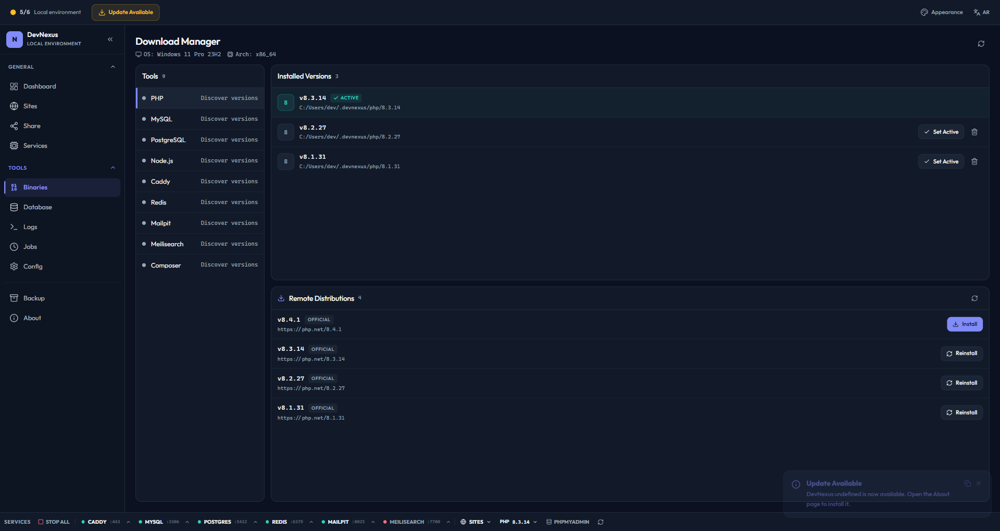
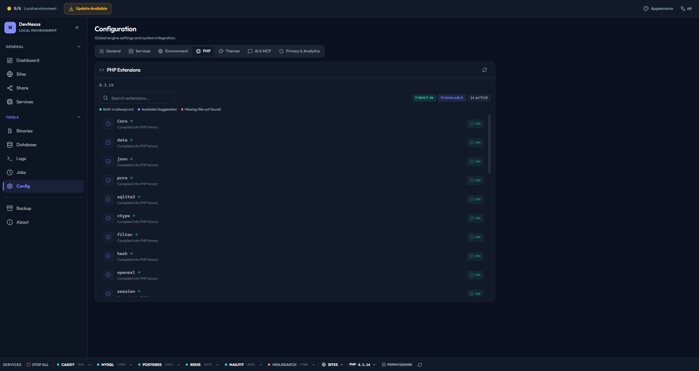
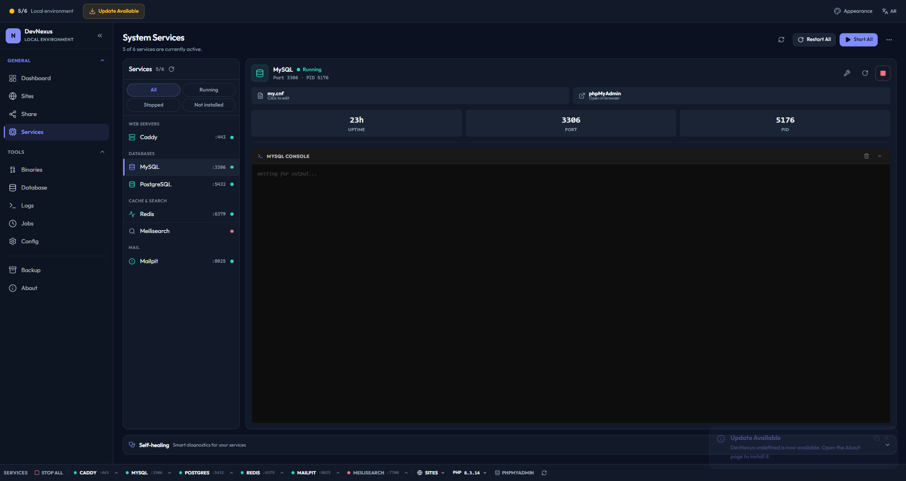
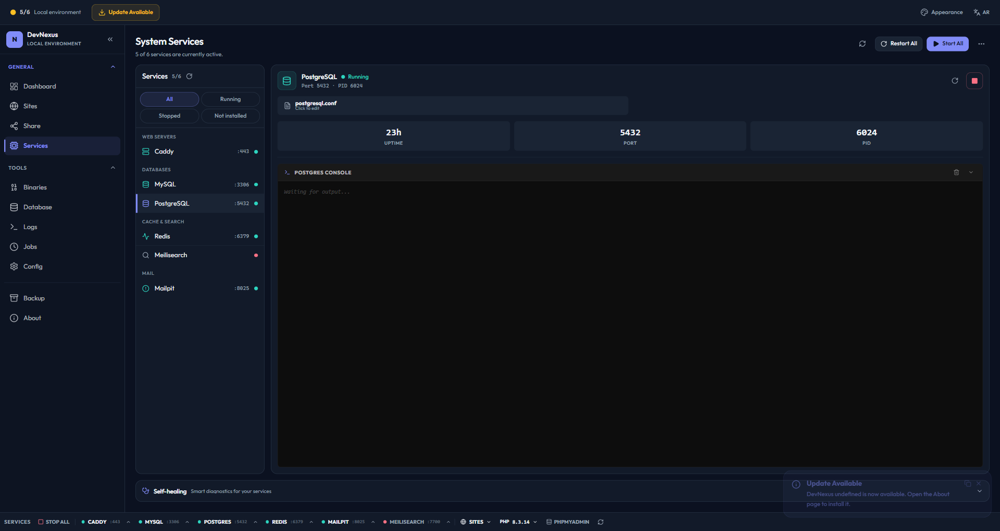
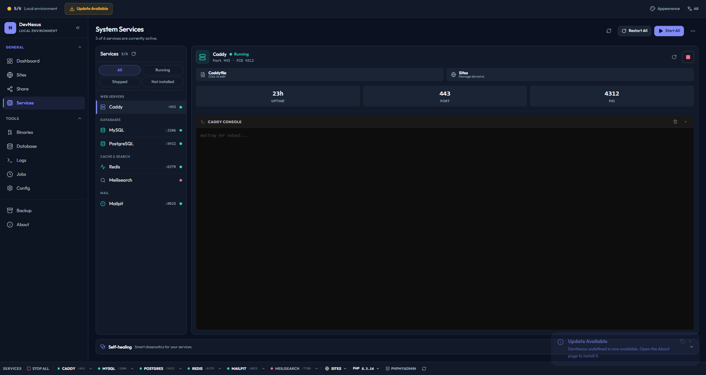
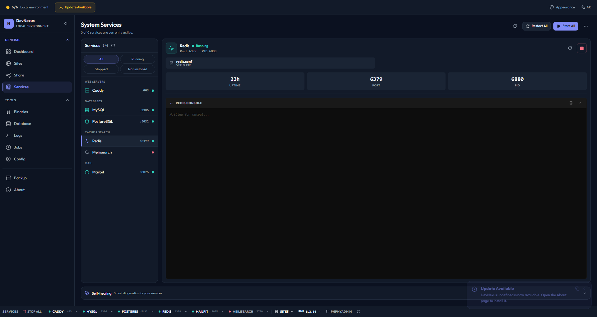
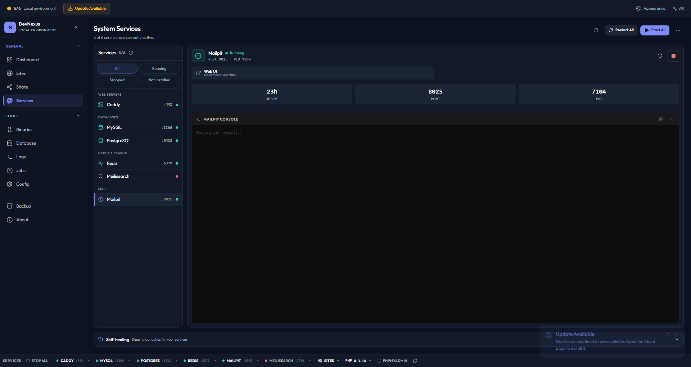
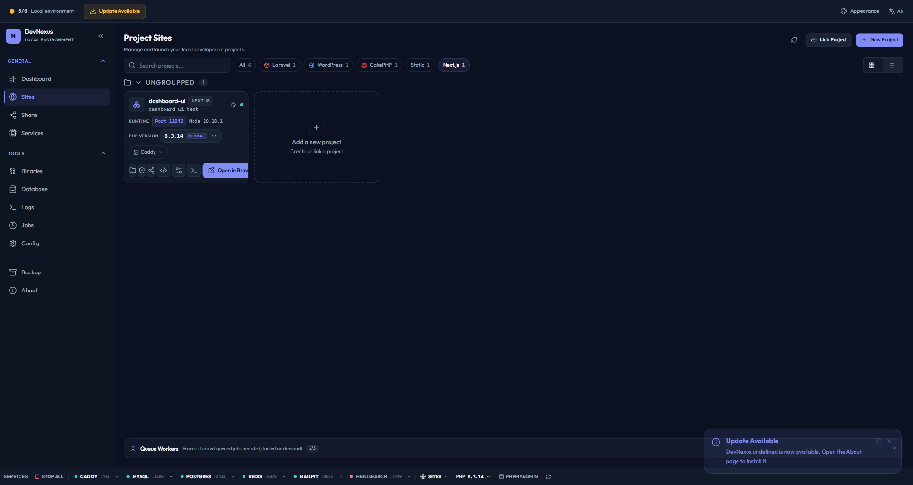

# Services

DevNexus manages several background services for your local development environment. Each service can be started, stopped, and configured independently.

---

## Service Overview


| Service | Binary | Default Port | Purpose |
|---------|--------|-------------|---------|
| **Caddy** | `caddy` | 80, 443 | Web server with auto-TLS |
| **MySQL** | `mysqld` | 3306 | Relational database |
| **PostgreSQL** | `postgres` | 5432 | Alternative database |
| **PHP-FPM** | `php-fpm` | Socket (tmp) | PHP FastCGI process manager |
| **Redis** | `redis-server` | 6379 | In-memory data store |
| **Mailpit** | `mailpit` | 1025 (SMTP), 8025 (UI) | Email testing |
| **Node.js** | `node`/`npm` | 11000–11999 | Frontend dev servers |

---

## PHP

### Version Management

DevNexus downloads pre-compiled PHP binaries from [static-php.dev](https://static-php.dev) and manages multiple versions side-by-side.



**Supported versions:** 8.0, 8.1, 8.2, 8.3, 8.4

**Features:**
- Install/remove PHP versions from the Binaries page
- Switch active PHP version globally
- Per-site PHP version via `.php-version` files or `.devnexus.json`
- Automatic `php.ini` generation with sensible defaults

### Extensions

View and manage PHP extensions from the Configuration page:



- **Built-in extensions:** Always enabled (core, openssl, mbstring, etc.)
- **Loadable extensions:** Toggle on/off (redis, imagick, xdebug, etc.)
- Cross-platform: `.so` (Linux), `.dylib` (macOS), `.dll` (Windows)

### PHP-FPM (Per-Site Isolation)

Each project gets its own dedicated PHP-FPM pool:

- Separate `php-fpm.conf` per site
- Different PHP versions can run simultaneously
- Pool configs stored in `config/php/fpm/`
- Automatic restart when configs change

### PHP Built-in Server

For lightweight development, DevNexus can use PHP's built-in server instead of FPM:

- Simpler setup for single-site development
- Automatic port assignment
- Suitable for static sites and simple PHP projects

### Xdebug

Xdebug is available on-demand:

- **Port:** 9003
- **Activation:** Via cookie or HTTP header (zero overhead in normal mode)
- **IDE Support:** VS Code, PHPStorm, NetBeans

---

## MySQL



**Configuration:**
- Data directory: `dev-stack/data/mysql/`
- Config file: `dev-stack/config/my.cnf` (or `my.ini` on Windows)
- Runs with `--no-defaults --skip-grant-tables` for local development
- User: `root`, no password

**phpMyAdmin Integration:**
- Auto-installed and served at `https://phpmyadmin.test`
- Direct database management through the web UI

**Database Management:**
- Create/drop databases from the GUI or CLI
- Export databases to SQL dumps
- Backup individual databases

---

## PostgreSQL



**Configuration:**
- Default port: 5432
- Config file: `dev-stack/config/postgresql.conf`
- Managed as a binary tool (download from the Binaries page)

---

## Caddy



Caddy is the web server that handles HTTP/HTTPS traffic for all your local sites.

**Features:**
- **Auto-TLS:** Automatic HTTPS certificates for `.test` domains
- **Per-site vhosts:** Each project gets its own virtual host configuration
- **PHP-FPM FastCGI:** Routes PHP requests to the correct FPM pool
- **Reverse proxy:** Proxies Node.js/Next/Vue dev servers on `*.test` domains
- **Live reload:** Configuration updates are applied automatically

**How it works:**

1. DevNexus generates a `Caddyfile` from your site configurations
2. Each site gets a vhost block with its domain, document root, and PHP handler
3. Node.js sites get reverse proxy entries pointing to their dev server ports
4. Caddy automatically provisions TLS certificates for all `.test` domains

**File watcher:** A background watcher monitors the Caddyfile and reloads Caddy when changes are detected.

---

## Redis



**Configuration:**
- Default port: 6379
- Config file: `dev-stack/config/redis.conf`
- Data directory: `dev-stack/data/redis/`

**Use cases:**
- Laravel cache driver
- Laravel queue backend
- Session storage
- Rate limiting

---

## Mailpit



Mailpit captures all outgoing email from your PHP applications.

| Protocol | Port | Purpose |
|----------|------|---------|
| SMTP | 1025 | Mail server (configure your app to send here) |
| Web UI | 8025 | Browse captured emails at `http://localhost:8025` |

**Laravel configuration:**

```env
MAIL_MAILER=smtp
MAIL_HOST=127.0.0.1
MAIL_PORT=1025
MAIL_USERNAME=null
MAIL_PASSWORD=null
MAIL_ENCRYPTION=null
```

---

## Node.js / NVM



DevNexus integrates with NVM (Node Version Manager) for per-project Node.js version management.

**Features:**
- Auto-detects Next.js, Vue, Vite, Express projects
- Reads `.nvmrc` files for per-project Node version
- Package manager detection from lockfiles (npm, yarn, pnpm, bun)
- Dev server reverse proxy via Caddy
- Deterministic dev ports (11000–11999) or per-site override

**How it works:**

1. DevNexus scans your project for `package.json`
2. Detects the framework (Next.js, Vue, etc.) and package manager
3. Reads `.nvmrc` or `.node-version` for the correct Node version
4. Starts the dev server on an available port
5. Configures Caddy to reverse proxy `https://your-site.test` → `localhost:<port>`

---

## Service Lifecycle

### Starting Services

```
Dashboard → Services → Start All (or toggle individual)
         → CLI: devnexus start-all
         → MCP: start_service tool
```

### Stopping Services

```
Dashboard → Services → Stop All (or toggle individual)
         → CLI: devnexus stop-all
         → MCP: stop_service tool
```

### Auto-Recovery

DevNexus includes self-healing diagnostics that detect and fix:

- **Stale PIDs:** Processes that crashed without cleaning up PID files
- **Port conflicts:** Another process using the same port
- **Corrupt configs:** Malformed Caddyfile, my.cnf, php-fpm.conf
- **Stopped services:** Services that should be running but aren't

Access from **Dashboard → Diagnostics** or via the MCP `get_dashboard_stats` tool.

---

## Related

- [Sites & Projects](./sites.md) — Per-site configuration
- [Configuration](./configuration.md) — Config file locations
- [CLI Reference](./cli.md) — Command-line service management
