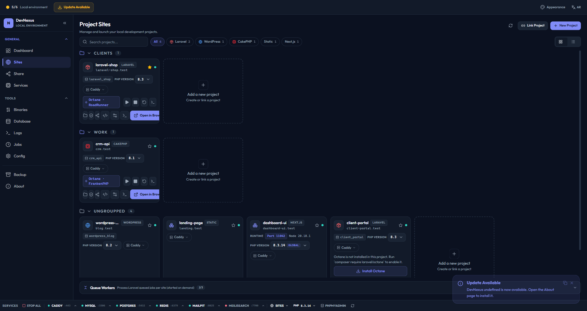
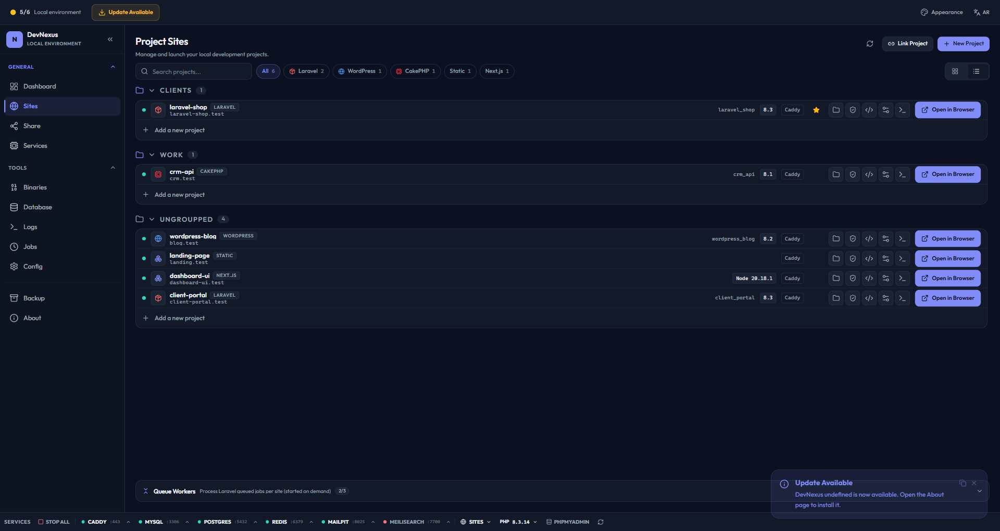
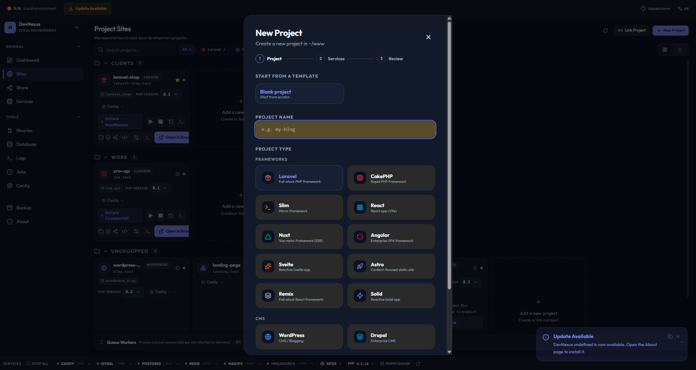
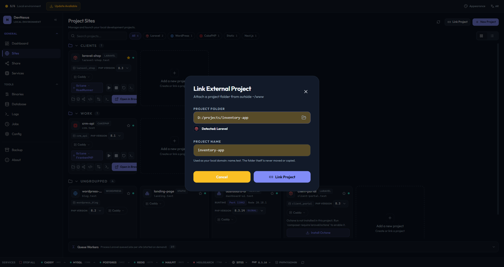
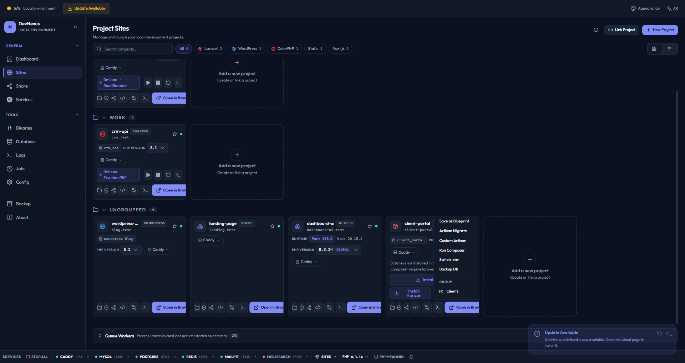

# Sites & Projects

DevNexus automatically discovers, configures, and manages your local web projects.

---

## Overview



DevNexus scans `~/www` for projects and supports linking projects from anywhere on disk. Each project gets:

- A `.test` domain (e.g., `my-app.test`)
- Automatic TLS certificate
- `/etc/hosts` entry
- Per-site PHP version (via `.php-version` or `.devnexus.json`)
- Caddy vhost configuration

---

## Project Discovery

DevNexus auto-detects project types by scanning for signature files:

| Project Type | Detection Signal |
|-------------|-----------------|
| **Laravel** | `artisan` file present |
| **WordPress** | `wp-settings.php` present |
| **CakePHP** | `bin/cake` present |
| **Slim** | `slim` in `composer.json` |
| **Generic PHP** | `composer.json` or `index.php` |
| **Static** | HTML files, no PHP framework detected |
| **Node.js** | `package.json` with framework detection |



---

## Creating a New Project

### From the GUI

1. Go to **Sites** → **Create Site**
2. Enter a project name
3. Select the project type
4. Click **Create**



DevNexus will:
1. Scaffold the project via `composer create-project` (Laravel) or equivalent
2. Configure the `.env` file with database credentials and `APP_URL`
3. Create a Caddy vhost entry
4. Add the `.test` domain to `/etc/hosts`
5. Generate an SSL certificate

### From the CLI

```bash
devnexus create-site --name my-app --type laravel
```

### From MCP

```
Tool: create_site_prompt
Parameters: { "name": "my-app", "site_type": "laravel" }
```

---

## Linking Existing Projects

Link projects that live outside `~/www`:

1. Go to **Sites** → **Link Project**
2. Browse to the project folder
3. DevNexus auto-detects the type and configures it



The project is now accessible at `https://<folder-name>.test`.

---

## Per-Site Configuration

Each project can have a `.devnexus.json` file in its root to override defaults:

```json
{
  "type": "laravel",
  "domain": "custom-domain.test",
  "php_version": "8.3",
  "document_root": "public",
  "node_port": 3000
}
```

| Field | Type | Description |
|-------|------|-------------|
| `type` | string | Override auto-detected project type |
| `domain` | string | Custom `.test` domain (default: folder name) |
| `php_version` | string | PHP version for this site (overrides global) |
| `document_root` | string | Subdirectory for web root (default: project root) |
| `node_port` | number | Fixed dev server port for Node.js projects |

---

## Automatic Bootstrap

DevNexus automatically configures new projects:

### Laravel

- Creates `.env` with database credentials
- Sets `APP_URL=https://<name>.test`
- Runs `php artisan key:generate`
- Configures MySQL database with matching name

### WordPress

- Creates `wp-config.php` with generated security keys
- Configures database credentials
- Sets WordPress salts automatically

### Node.js

- Detects package manager from lockfiles
- Reads `.nvmrc` for Node version
- Assigns dev server port (11000–11999)
- Configures Caddy reverse proxy

---

## Site Management

### Open in Browser

Click the browser icon or use MCP to open `https://<site>.test`.

### Open in File Manager

Opens the project folder in Explorer/Finder/Nautilus.

### Run Artisan / Composer

Execute Laravel Artisan or Composer commands from the GUI or MCP:



**Examples:**
- `php artisan migrate`
- `php artisan queue:work`
- `composer require spatie/laravel-permission`

### Git Status

View branch, modified files, and staged changes for any linked project.

### Queue Workers

Manage Laravel queue workers per site:

- Start/stop/restart with PID tracking
- Status monitoring
- Log viewing

---

## Domain Resolution

DevNexus manages `/etc/hosts` entries for all sites:

```
127.0.0.1  my-app.test
127.0.0.1  blog.test
127.0.0.1  api.test
```

The `repair-hosts` utility can re-synchronize entries if they become corrupted:

```bash
repair-hosts
```

---

## SSL / TLS

DevNexus uses Caddy's built-in TLS for `.test` domains:

1. Caddy automatically provisions certificates for all configured domains
2. The root CA certificate is injected into the system certificate store
3. Browsers trust the certificates without warnings

**Trust injection:**
- Linux: `update-ca-certificates`
- macOS: Keychain
- Windows: Certificate store via PowerShell

---

## Related

- [Services](./services.md) — Service management
- [Configuration](./configuration.md) — Config file details
- [MCP Server](./mcp.md) — AI-assisted project management
- [CLI Reference](./cli.md) — Command-line site operations
